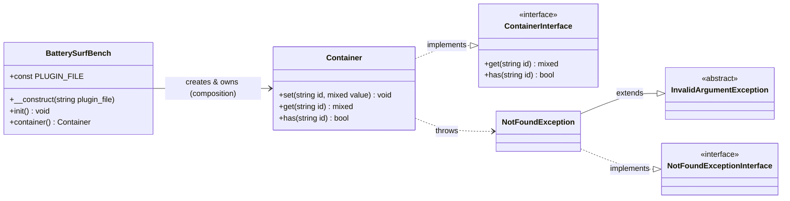

# PHP Class Interactions

**Contract — not implementation.** This chart is the authoritative picture of how the
plugin's PHP classes relate to one another. It shows only the public surface each class
exposes to the rest of the system; private state and internal helpers are deliberately
omitted. If the code and this chart disagree, one of them is wrong — and per `CLAUDE.md`,
the chart wins until the code is reconciled.

## Class diagram

## Relationships

| From | To | Kind | Meaning |
| --- | --- | --- | --- |
| `BatterySurfBench` | `Container` | Composition | The bootstrap builds the container in `init()` and owns its lifecycle; the container does not outlive its owner. Exposed to consumers via `container()`. |
| `Container` | `ContainerInterface` | Realization | `Container` is a minimal PSR-11 implementation. Consumers may depend on the interface rather than the concrete class. |
| `Container` | `NotFoundException` | Dependency | `get()` throws `NotFoundException` when no entry is registered for the requested identifier. |
| `NotFoundException` | `InvalidArgumentException` | Inheritance | Reuses the SPL exception so existing `InvalidArgumentException` handlers still catch it. |
| `NotFoundException` | `NotFoundExceptionInterface` | Realization | Satisfies the PSR-11 not-found contract, so PSR-11-aware consumers can catch it by interface. |

## Notes

- **`PLUGIN_FILE`** is the container key under which the bootstrap registers the absolute
  plugin-file path (`init()` calls `$container->set(self::PLUGIN_FILE, $plugin_file)`).
  It is the one piece of configuration the container holds today.
- **PSR-11 boundary.** `ContainerInterface` and `NotFoundExceptionInterface` come from the
  `psr/container` package — they are external abstractions the plugin implements, not types
  it defines. They are shown here because the plugin's classes contract against them.
- **`InvalidArgumentException`** is the PHP SPL base class; it is included only to show why
  `NotFoundException` is dual-typed (SPL + PSR-11).
- The plugin entry file `battery-surf-bench.php` is the only caller of
  `new BatterySurfBench(...)->init()`; it is procedural glue, not a class, so it does not
  appear as a node.
